<p align="center">
  <picture>
    <source media="(prefers-color-scheme: dark)" srcset="frontend/assets/logo-dark.svg">
    
  </picture>
</p>

<p align="center">
  <b>Your private, local AI research assistant.</b><br>
  Understand papers, analyse data and draft academic text, all on your own computer.
</p>

<p align="center">
  
  
  
  
  
  
  
</p>

---

Scholaria is a full-stack research workspace for students, academics and research professionals.
It runs **entirely on your machine**: a small quantized language model served by [Ollama](https://ollama.com),
a FastAPI backend, a SQLite database and a Streamlit interface. No cloud AI services, no API keys and no
telemetry. It was built for and tested on an **Apple M1 MacBook with 8 GB of memory**.

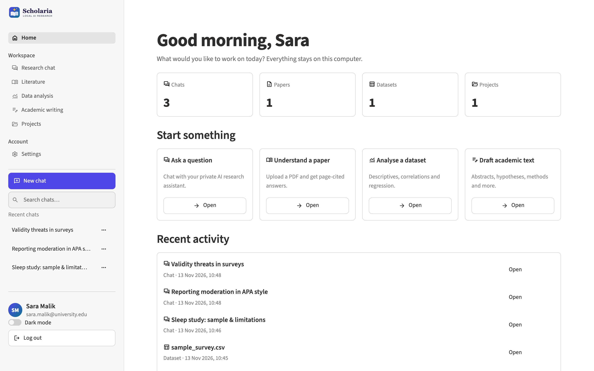

## Contents

- [Features](#features)
- [Screenshots](#screenshots)
- [Quick start](#quick-start)
- [Using Scholaria](#using-scholaria)
- [How it stays trustworthy](#how-it-stays-trustworthy)
- [Architecture](#architecture)
- [Configuration](#configuration)
- [Development and testing](#development-and-testing)
- [Privacy and security](#privacy-and-security)
- [Troubleshooting](#troubleshooting)
- [Roadmap](#roadmap)
- [License](#license)

## Features

| | |
|---|---|
| **Research chat** | Streaming chat with stop, regenerate, copy and persistent history. Rename, delete and search chats from the sidebar. Pick a model and an assistant persona, and adjust temperature, context and response length. Optionally ground answers in your papers, with page-referenced sources. |
| **Literature assistant** | Upload PDF, DOCX or TXT files. Text is extracted with page numbers, chunked and indexed with SQLite FTS5. Ask questions and get answers cited as `[S1]`, with the real page number from the database. Summarise a whole paper, or extract objectives, research questions, theoretical framework, methodology, sample, variables, findings, limitations and future research. |
| **Data analysis** | CSV and Excel uploads with preview, data types, missing values and duplicates. Descriptive statistics, frequencies, correlations (Pearson, Spearman, Kendall) with p-values, OLS regression with diagnostics (VIF, Durbin-Watson, Breusch-Pagan, Shapiro-Wilk), histograms and scatter plots. Every run is saved and exportable to Excel, CSV or JSON, and AI can explain *computed* results. |
| **Academic writing** | 15 guided workflows: titles, abstract, introduction, literature review, research gap, hypotheses, research questions, methodology, results, discussion, conclusion, language polishing, grammar, paraphrasing and LaTeX. |
| **Projects** | Organise objectives, research questions, hypotheses, notes, a bibliography (BibTeX export) and linked papers, datasets and chats. |
| **Accounts** | Sign up and log in. Each account sees only its own data. Passwords are hashed with scrypt, sessions can be remembered for 30 days, and there is a dark/light toggle. |

## Screenshots

| | |
|---|---|
| 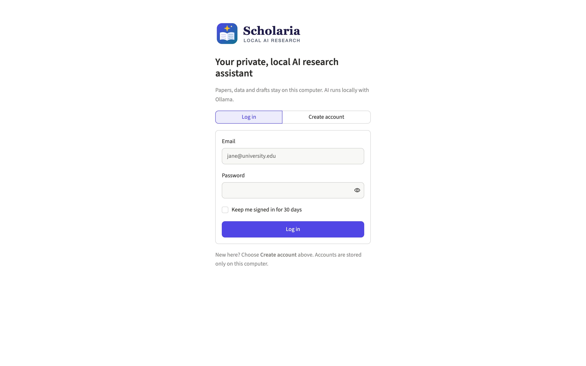 | 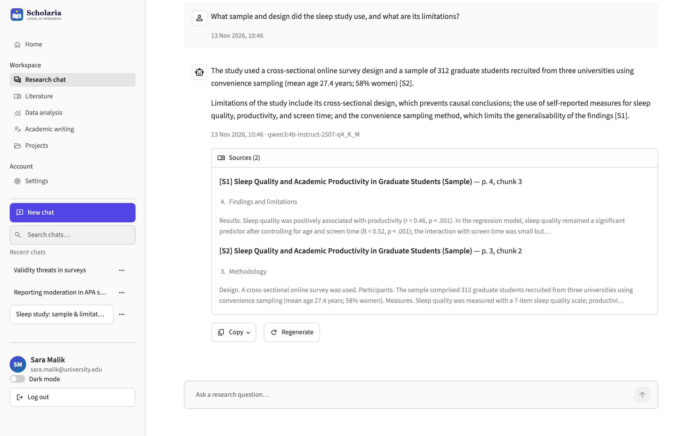 |
| **Sign in / create account**: accounts live only on your computer | **Grounded chat**: answers cite your paper, with real page numbers |
| 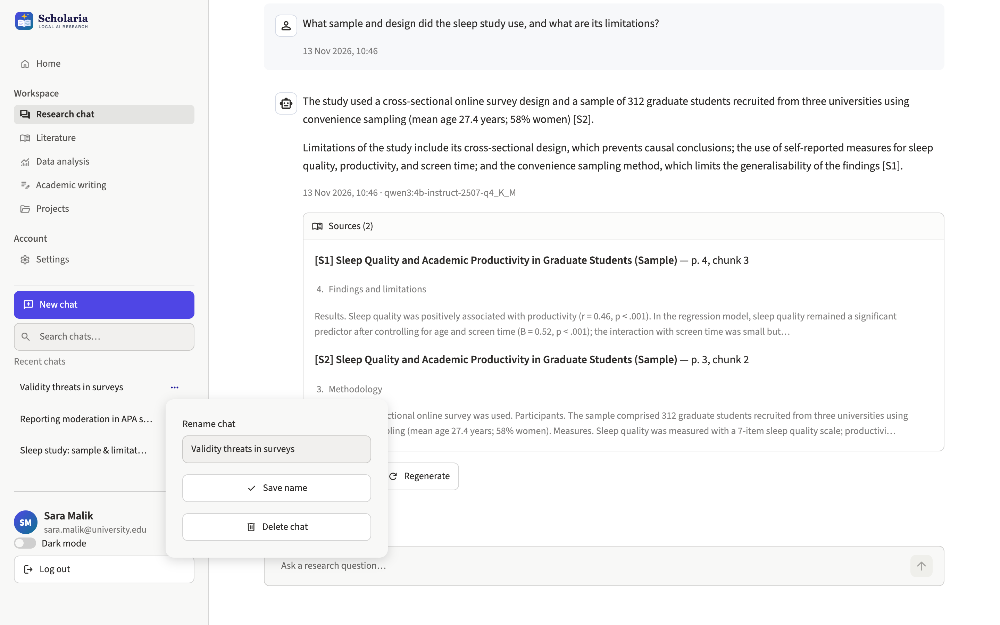 | 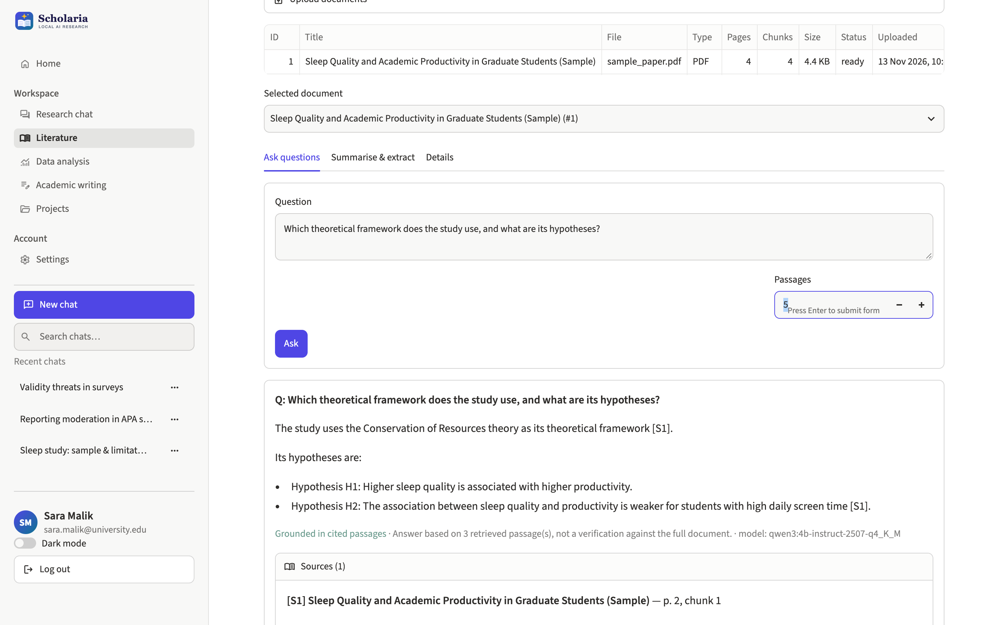 |
| **Rename or delete any chat** from the sidebar | **Literature assistant**: ask a paper anything |
| 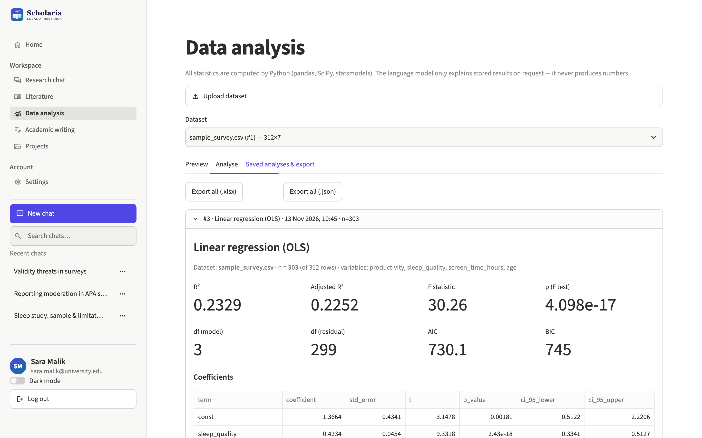 | 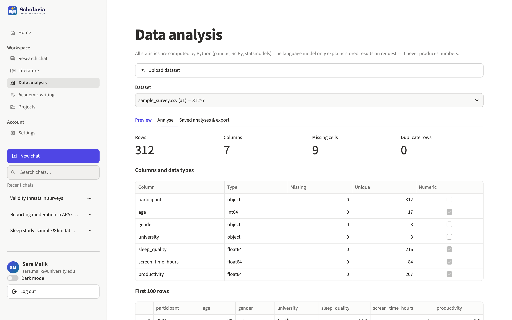 |
| **Regression** computed by statsmodels, never by the LLM | **Dataset preview** with types, missing values and duplicates |
| 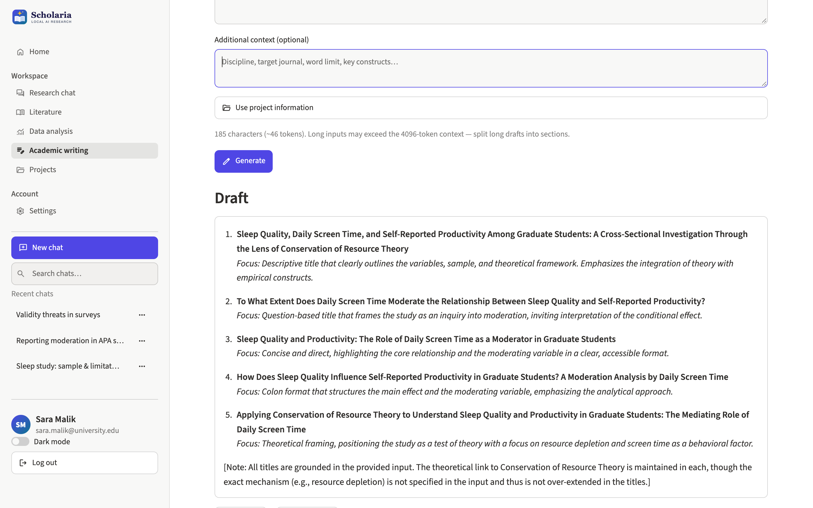 | 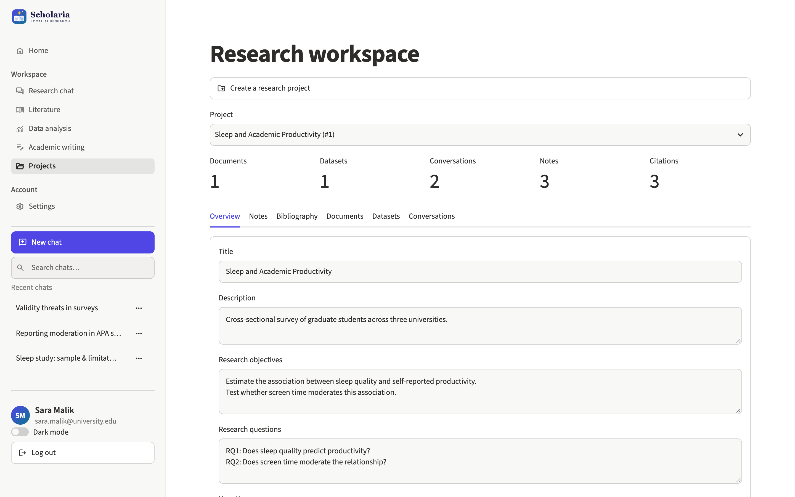 |
| **Academic writing** workflows | **Projects** keep a study's material together |
| 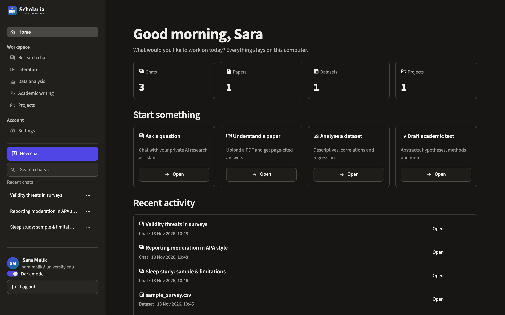 | 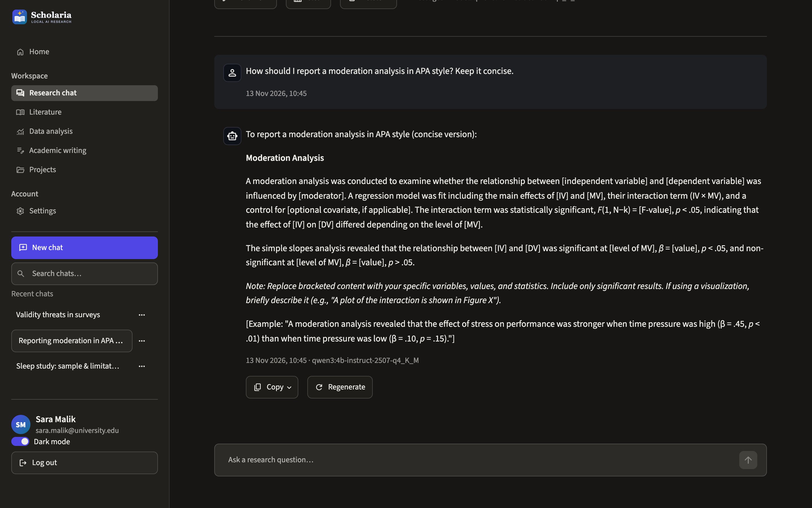 |
| **Dark mode**, one toggle in the sidebar | Dark mode chat |

<details>
<summary>Settings</summary>

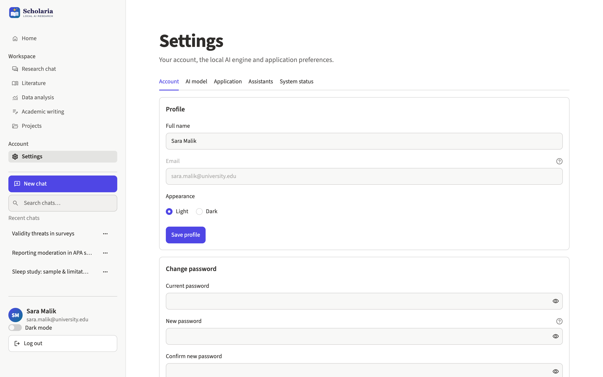
</details>

> The paper and dataset in the screenshots are the fictional samples in [`samples/`](samples/).

## Quick start

**Requirements:** macOS on Apple Silicon (Linux also works), Python 3.11, [Ollama](https://ollama.com), and about 5 GB of free disk space.

```bash
# 1. Get the code
git clone https://github.com/mohakamran/scholaria.git
cd scholaria

# 2. Install Ollama and the models (one-time, ~4 GB)
brew install ollama
ollama serve &                                 # or open the Ollama app
ollama pull qwen3:4b-instruct-2507-q4_K_M      # main model (~2.5 GB)
ollama pull qwen3:1.7b                         # smaller fallback (~1.4 GB)

# 3. Set up and start Scholaria
./scripts/setup.sh                             # checks prerequisites, creates .venv, migrates the DB
./scripts/start.sh --open                      # starts everything and opens the browser
```

Open **<http://127.0.0.1:8501>**, choose **Create account**, and you're in. Stop everything with `./scripts/stop.sh`.

| Command | What it does |
|---|---|
| `make setup` | Check prerequisites, create the Python 3.11 virtual environment, install dependencies, migrate the database |
| `make start` / `make stop` | Start or stop Ollama (if Scholaria started it), the API and the UI |
| `make test` | Run the test suite (no model needed) |
| `make migrate` | Apply database migrations |
| `.venv/bin/python scripts/manage.py list-users` | List local accounts |
| `.venv/bin/python scripts/manage.py reset-password you@example.com` | Reset a forgotten password |

`setup.sh` never installs system-wide packages and never overwrites an existing `.env`. If Python 3.11 is
missing it tells you how to install it (`brew install python@3.11`), or uses [uv](https://github.com/astral-sh/uv) if available.

| Service | URL |
|---|---|
| Scholaria app | <http://127.0.0.1:8501> |
| REST API | <http://127.0.0.1:8000> |
| Interactive API docs | <http://127.0.0.1:8000/docs> |

## Using Scholaria

1. **Ask a question.** Click **New chat** and type, or pick one of the starter prompts. To get answers from
   your own papers, select them under *Ground answers in documents*.
2. **Understand a paper.** Go to **Literature**, upload a PDF, then ask questions or run *Summarise & extract*.
   Each answer lists its sources with the page they came from.
3. **Analyse data.** Upload a CSV or Excel file in **Data analysis**, preview it, run an analysis, and export
   the results. *Explain these results with AI* writes an interpretation of the stored numbers.
4. **Write.** In **Academic writing**, choose a task, paste your text or study details, and generate. Tick
   *Allow citing the project bibliography* so the draft can cite only the references you entered.
5. **Organise.** Create a **Project** to keep objectives, notes, references, papers, datasets and chats together.
6. **Personalise.** Use the sidebar toggle for dark mode, and **Settings** for your profile, password, model and limits.

Try it with the bundled fictional samples: `samples/sample_paper.pdf` and `samples/sample_survey.csv`.

## How it stays trustworthy

Small local models are fluent but can invent things. Scholaria adds **code-level checks** rather than relying only on prompts:

- **Citations come from the database.** The model sees passages labelled `[S1]…[Sn]` and may cite only
  those labels. Labels it invents are removed. The title and page shown for each source come from
  SQLite, never from the model.
- **Invalid page references are removed.** In summaries, any `(p. N)` that does not exist in the
  processed text is replaced and counted.
- **No evidence, no answer.** If nothing relevant is retrieved, the model is not called and you are told so.
  Answers state how many passages were used and that they are not a whole-paper verification.
- **Numbers come only from Python.** Every statistic is computed by predefined pandas, SciPy or statsmodels
  functions with validated column names. The model can only explain stored results. No generated code is ever executed.
- **Writing doesn't invent sources.** Drafts may cite only bibliography entries you entered, and
  the app warns when a draft attributes a claim to an entry that has no notes about what that source reports.
- **Uploaded documents are treated as untrusted data**, wrapped in delimiters so instructions inside them are ignored.

## Architecture

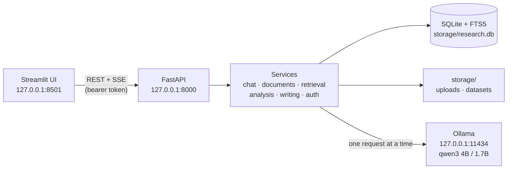

```
scholaria/
├── backend/
│   ├── app/
│   │   ├── main.py            # FastAPI app, error handlers, startup (migrate + seed)
│   │   ├── api/               # routes: auth, health, models, chat, documents, research, datasets, writing
│   │   ├── services/          # ollama, chat, auth, document, retrieval, analysis, writing, storage, settings
│   │   ├── database/          # engine + FTS5, ORM models, per-account repositories
│   │   ├── schemas/           # Pydantic request/response models
│   │   └── core/              # config, logging, errors, prompts
│   ├── migrations/            # Alembic (0001 schema + FTS5, 0002 accounts)
│   └── tests/                 # 64 pytest tests (Ollama mocked)
├── frontend/
│   ├── app.py                 # auth gate, navigation, sidebar, theme
│   ├── views/                 # home, chat, literature, data, writing, projects, settings, sign-in
│   ├── components/            # API client, auth/session cookie, UI helpers, analysis rendering
│   └── assets/                # logo and icon (SVG)
├── scripts/                   # setup.sh, start.sh, stop.sh, manage.py
├── samples/                   # fictional sample paper + dataset (and their generator)
├── docs/                      # API reference, troubleshooting, screenshots
└── storage/                   # your data (git-ignored)
```

**Designed for 8 GB of memory:** one inference at a time (a process-wide semaphore), a 4096-token context
(never the model's advertised maximum), the model unloads after 2 idle minutes, conversation history trimmed
to a token budget, PDFs read page by page, map-reduce summaries, and at most one DataFrame cached. With the
4B model loaded, Ollama uses about 3.2 GB, the API about 150 MB and the UI about 80 MB.

## Configuration

Copy `.env.example` to `.env` (done by `setup.sh`). All settings use the `RA_` prefix:

| Variable | Default | Notes |
|---|---|---|
| `RA_OLLAMA_URL` | `http://127.0.0.1:11434` | Must be a local address |
| `RA_DEFAULT_MODEL` | `qwen3:4b-instruct-2507-q4_K_M` | Any installed Ollama model works |
| `RA_FALLBACK_MODEL` | `qwen3:1.7b` | Used when the default isn't installed |
| `RA_CONTEXT_LENGTH` | `4096` | Larger values need more memory |
| `RA_MAX_TOKENS` | `1024` | Maximum response length |
| `RA_KEEP_ALIVE` | `2m` | How long the model stays loaded when idle |
| `RA_MAX_UPLOAD_MB` / `RA_MAX_DATASET_MB` | `25` / `20` | Upload limits |
| `RA_API_PORT` / `RA_FRONTEND_PORT` | `8000` / `8501` | Change if the ports are taken |

Model, temperature, context, limits and the default assistant can also be changed in **Settings → AI model** at runtime.

## Development and testing

```bash
make test        # 64 tests: API, auth & data isolation, streaming, retrieval, statistics, uploads, writing
```

The tests replace Ollama with an `httpx.MockTransport`, so they need no model and run in about 10 seconds.

Before release, the app was also tested by hand against the real `qwen3:4b` model. The checks covered:

- sign-up validation, wrong-password handling, remember-me, logout and deep links
- isolation between two accounts
- chat streaming, stop, rename and delete
- grounded document Q&A with correct page references
- whole-document summaries, regression and AI interpretation
- the dark/light toggle and a restart

Run the backend and UI separately while developing:

```bash
.venv/bin/python -m uvicorn app.main:app --app-dir backend --reload
RA_API_URL=http://127.0.0.1:8000 .venv/bin/python -m streamlit run frontend/app.py
```

The full REST reference is in [docs/API.md](docs/API.md), and interactive docs are at `/docs`.

## Privacy and security

- The API, UI and Ollama all bind to **127.0.0.1**. Nothing is exposed to the network, and Streamlit telemetry is off.
- Passwords are hashed with **scrypt** and a per-user salt. The database stores only SHA-256 hashes of login
  tokens. Repeated failed logins are throttled. Error messages never reveal whether an email exists.
- Every query is **scoped to the logged-in account**. Other accounts' records return `404`.
- Uploads are checked against an extension allow-list and file signatures, size-limited while streaming,
  and stored under random names (no path traversal). They are never executed.
- Logs record IDs, sizes and statuses, never message or document text.
- `.env`, the database and all uploaded files are git-ignored.

Scholaria is designed for a personal computer or a small trusted group on one machine. It is not hardened
for deployment on the public internet.

## Troubleshooting

See [docs/TROUBLESHOOTING.md](docs/TROUBLESHOOTING.md). The most common issues:

- **"Ollama is not running"**: run `ollama serve` or open the Ollama app.
- **"Model not installed"**: run `ollama pull qwen3:4b-instruct-2507-q4_K_M`.
- **Out of memory**: close heavy apps, lower the context length, or switch to `qwen3:1.7b` in Settings.
- **Forgot password**: run `.venv/bin/python scripts/manage.py reset-password you@example.com`.

## Roadmap

The retrieval layer is behind a small `Retriever` interface, so these can be added without changing callers:

- Semantic and hybrid search with local embeddings (ChromaDB or FAISS)
- OCR for scanned PDFs
- Zotero / BibTeX import
- Structural equation modelling and advanced statistics
- Multi-step research agents

## License

[MIT](LICENSE) © 2026 Muhammad Kamran
